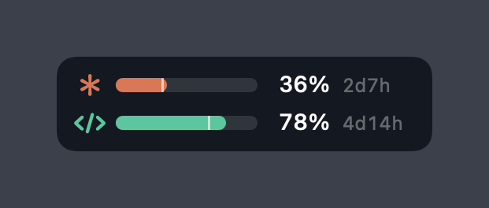
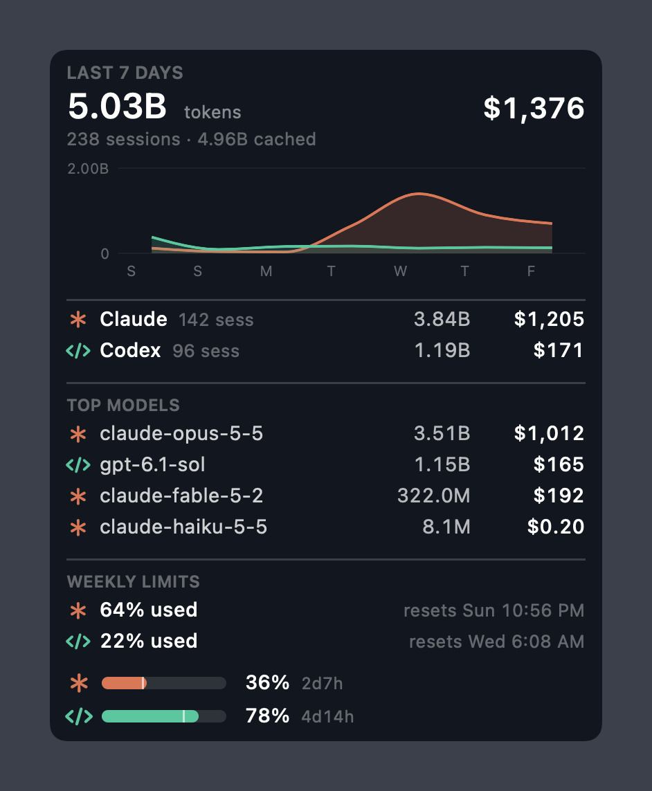

# UsageBar

A tiny always-visible macOS widget that shows how much of your **weekly Claude and Codex allowance** you have left. It sits in the bottom-left corner of your main display, and expands on hover to show 7-day token, cost, and session stats.

<p>
  
  &nbsp;&nbsp;
  
</p>

<sub>Screenshots use sample data.</sub>

## What it shows

**Always visible (compact bar)**

- One bar per tool, battery-style: the fill is the share of the weekly limit you have **left**.
- The white tick marks an even pace through the week. Fill left of the tick means you're using it faster than the week is passing.
- A dim countdown to the next weekly reset. Bars turn red at 10% left or less.

**On hover**

- Total tokens, estimated API-equivalent cost, and sessions for the last 7 days
- A daily chart per tool
- Per-tool and top-model breakdown
- Exact weekly reset times

## Requirements

- macOS 14 (Sonoma) or later
- Xcode Command Line Tools (`xcode-select --install`) to build
- Signed in to [Claude Code](https://claude.com/claude-code) and/or the [Codex CLI](https://github.com/openai/codex) on the same Mac

Either tool is optional. A tool you don't use just shows as unavailable.

## Install

```bash
git clone https://github.com/PwntasticKev/usagebar.git
cd usagebar
./scripts/install.sh
```

This builds `UsageBar.app`, copies it to `/Applications`, and registers a LaunchAgent so it starts at login.

**Uninstall:** `./scripts/uninstall.sh`

**Build only (no install):** `./scripts/build.sh` puts the app in `./build/UsageBar.app`.

### Prebuilt download

Each [release](https://github.com/PwntasticKev/usagebar/releases) has a zipped Apple Silicon build. It's ad-hoc signed, not notarized, so macOS will block it on first launch. After unzipping and moving it to `/Applications`, run:

```bash
xattr -dr com.apple.quarantine /Applications/UsageBar.app
open /Applications/UsageBar.app
```

Building from source avoids this step.

## Using it

- **Hover** to expand. Move away to collapse.
- **Right-click** for: Refresh Now, Open Claude Usage, Open Codex Usage, Quit.
- It lives on **one desktop** (Space) of your main display and doesn't follow you when you swipe. To move it to the desktop you're on, open `UsageBar` from Applications again.
- It stays hidden over full-screen apps.

## How it works, and what it touches

UsageBar stores no credentials of its own, and sends nothing anywhere except the official usage endpoints below.

| Data | Source | Access |
|---|---|---|
| Claude weekly limit | Claude Code's OAuth token in your login Keychain (`Claude Code-credentials`), sent only to `api.anthropic.com` | read-only |
| Codex weekly limit | `~/.codex/auth.json`, sent only to `chatgpt.com` | read-only |
| Codex limit (offline fallback) | latest `rate_limits` entry in `~/.codex/sessions` | read-only |
| Token, cost, and session stats | local session logs in `~/.claude/projects` and `~/.codex/sessions` | read-only, never uploaded |
| Model prices | the [LiteLLM price list](https://github.com/BerriAI/litellm), cached in `~/Library/Caches/UsageBar` | public download |

- **Refresh timing.** Limits refresh every 60 seconds and after wake from sleep. Stats are rescanned every 5 minutes; after the first scan, only newly appended log lines are read.
- **Undocumented endpoints.** The two limit endpoints are the same ones the Claude and ChatGPT settings pages use. They aren't public APIs and could change.
- **Expired logins.** If a login expires, the bar keeps the last value and shows a ⚠︎. Running `claude` or opening Codex once refreshes it.
- **Cost is an estimate.** It's what the same tokens would cost at API list prices, not what your subscription charges you.

## Project layout

```
Sources/
  main.swift, AppDelegate.swift    app lifecycle, hover/expand, menu
  FloatingPanel.swift              borderless panel pinned to the corner
  BarView.swift, DetailView.swift  SwiftUI views
  ClaudeProvider.swift             Claude weekly limit
  CodexProvider.swift              Codex weekly limit
  CodexLogReader.swift             Codex offline fallback
  LogScanner.swift                 incremental JSONL log scanning
  LogLineParsers.swift             Claude/Codex log line parsing
  JSONLReader.swift                fast line reader
  StatsAggregator.swift            7-day rollups
  PricingTable.swift               LiteLLM price lookup
scripts/
  build.sh, install.sh, uninstall.sh, make-icon.swift
```

## License

MIT
